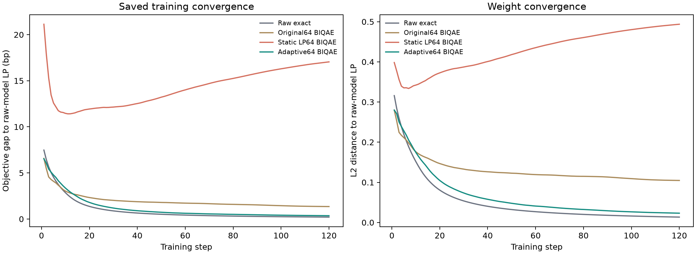
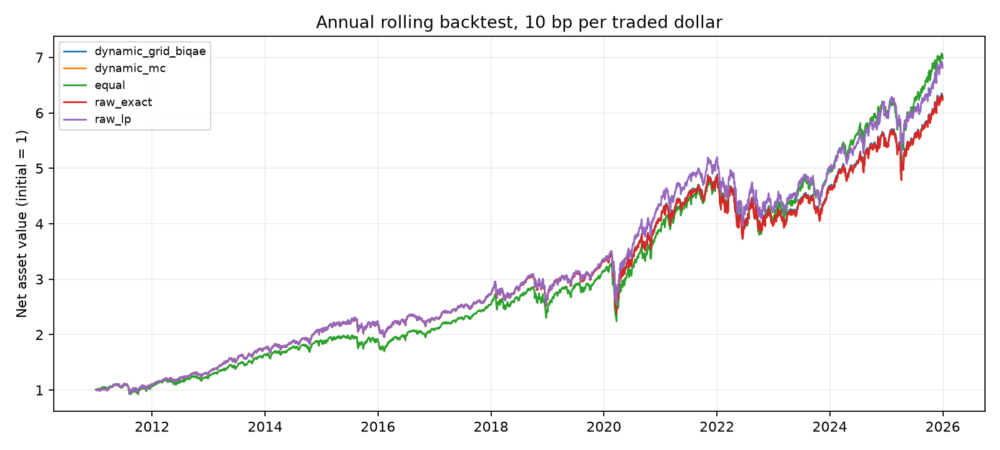

# 方案三实验结果与结论

## 1. 修正经典基线后的训练结果（各30种子）

| 方法 | 测试ES均值 | 种子标准差bp | 距精确梯度权重距离 | 距LP权重距离 |
|---|---|---|---|---|
| 等权 | 2.930398% | — | 0.49339 | 0.51962 |
| 精确梯度 | 2.725964% | — | 0.00000 | 0.11117 |
| BIQAE | 2.727519% | 2.7194 | 0.05045 | 0.10854 |
| IQAE | 2.731838% | 3.0514 | 0.05636 | 0.11840 |
| IS | 2.725960% | 0.0069 | 0.00025 | 0.11114 |
| LP | 2.687108% | — | 0.11117 | 0.00000 |
| MC | 2.725995% | 0.0131 | 0.00061 | 0.11117 |
| QMC | 2.725965% | 0.0005 | 0.00002 | 0.11117 |

BIQAE相对精确梯度的测试ES均值高0.05702%；BIQAE−MC平均差+0.1524bp，95%配对区间[-0.7885,+1.1499]bp。**接近参考的结论保留，优于MC的结论不成立。** 区间反映训练种子随机性，不代表未来市场保证。

## 2. 三个时间窗口的测试结果

| 方法 | 2011–2015测试ES | 2016–2020测试ES | 2021–2025测试ES |
|---|---|---|---|
| 等权 | 2.760131% | 3.876150% | 2.930398% |
| MC | 2.595533% | 3.676264% | 2.725016% |
| QMC | 2.595587% | 3.676657% | 2.724991% |
| IS | 2.595562% | 3.676643% | 2.724951% |
| IQAE | 2.593214% | 3.678165% | 2.728615% |
| BIQAE | 2.593936% | 3.676219% | 2.730005% |
| 精确梯度 | 2.595588% | 3.676669% | 2.724989% |
| LP | 2.574776% | 3.546704% | 2.687108% |

BIQAE相对精确梯度的ES均值差分别为−0.06367%、−0.01223%、+0.18405%。**接近参考的现象不限于原窗口，尚无跨市场优势证据。**

## 3. 同误差查询量与可靠性（3000次）

| 水平 | 目标bp | MC | QMC | IS | IQAE | BIQAE |
|---|---|---|---|---|---|---|
| 95% | 5 | 65,536 | 4,096 | 16,384 | 54,206 | 53,056 |
| 95% | 10 | 16,384 | 4,096 | 16,384 | 54,206 | 53,056 |
| 95% | 20 | 4,096 | 4,096 | 4,096 | 16,384 | 16,358 |
| 97.5% | 5 | 网格内未认证 | 4,096 | 16,384 | 57,459 | 55,572 |
| 97.5% | 10 | 16,384 | 4,096 | 4,096 | 57,459 | 55,572 |
| 97.5% | 20 | 16,384 | 4,096 | 4,096 | 57,459 | 55,572 |

表内为单配置95%成功率置信下界达到95%时，最小已测预算对应的平均实际查询。97.5%水平5bp目标下，MC为99/100成功、下界94.55%；BIQAE为100/100、下界96.38%。全网格同时校正后，100/100下界仅93.80%，未取得全网格95%可靠性认证。**当前完整已知离散表任务中，QMC更省查询。**

| 水平 | 方法 | 预算65536的ES误差bp | VaR/ES区间宽bp | VaR/ES覆盖率 |
|---|---|---|---|---|
| 95% | BIQAE | 0.509 | 0.000/5.107 | 100%/100% |
| 95% | IQAE | 0.565 | 0.000/5.256 | 100%/99% |
| 95% | IS | 0.637 | 46.918/272.167 | 100%/100% |
| 95% | MC | 1.243 | 0.469/103.085 | 100%/100% |
| 95% | QMC | 0.004 | 0.000/0.297 | 100%/100% |
| 97.5% | BIQAE | 0.641 | 0.000/6.084 | 100%/100% |
| 97.5% | IQAE | 0.731 | 0.000/6.390 | 100%/100% |
| 97.5% | IS | 0.567 | 167.296/406.225 | 100%/100% |
| 97.5% | MC | 1.304 | 40.184/143.218 | 100%/100% |
| 97.5% | QMC | 0.003 | 0.000/0.593 | 100%/100% |

QMC在4096预算也通过5bp点误差与区间半宽联合要求；MC/IS在已测预算内未通过该区间精度要求。经典样本与A/A†调用不是同等硬件成本；高覆盖率不等于区间足够窄。

## 4. 厚尾与压力分布结果（6000次）

| 分布 | 水平 | VaR分箱偏差bp | ES分箱偏差bp |
|---|---|---|---|
| Student-t厚尾 | 95% | -11.853 | -15.080 |
| Student-t厚尾 | 97.5% | 2.787 | -20.278 |
| 压力混合 | 95% | -14.981 | -18.518 |
| 压力混合 | 97.5% | 5.595 | -23.378 |

两类分布、两个风险水平下，QMC在4096预算达到5bp离散精度目标，IS需16384，IQAE/BIQAE需65536。最高预算下，所有方法相对原始生成样本的5/10bp联合成功率均为0。**强经典基线更省查询、分箱主导总误差的结果在新增分布中仍成立。**

| 分布 | 水平 | 方法 | 预算65536的ES误差bp | ES覆盖率 | ES区间宽bp |
|---|---|---|---|---|---|
| 压力 | 95% | BIQAE | 0.875 | 100% | 7.575 |
| 压力 | 95% | IQAE | 0.985 | 99% | 7.658 |
| 压力 | 95% | IS | 0.903 | 100% | 372.218 |
| 压力 | 95% | MC | 1.888 | 100% | 145.603 |
| 压力 | 95% | QMC | 0.006 | 100% | 0.419 |
| 压力 | 97.5% | BIQAE | 0.791 | 100% | 8.487 |
| 压力 | 97.5% | IQAE | 1.014 | 100% | 9.120 |
| 压力 | 97.5% | IS | 0.717 | 100% | 542.880 |
| 压力 | 97.5% | MC | 1.741 | 100% | 199.188 |
| 压力 | 97.5% | QMC | 0.004 | 100% | 0.838 |
| 厚尾 | 95% | BIQAE | 0.506 | 100% | 4.979 |
| 厚尾 | 95% | IQAE | 0.497 | 100% | 5.058 |
| 厚尾 | 95% | IS | 0.611 | 100% | 283.140 |
| 厚尾 | 95% | MC | 1.240 | 100% | 103.583 |
| 厚尾 | 95% | QMC | 0.003 | 100% | 0.298 |
| 厚尾 | 97.5% | BIQAE | 0.598 | 100% | 6.737 |
| 厚尾 | 97.5% | IQAE | 0.694 | 100% | 6.534 |
| 厚尾 | 97.5% | IS | 0.682 | 100% | 413.083 |
| 厚尾 | 97.5% | MC | 1.599 | 100% | 152.805 |
| 厚尾 | 97.5% | QMC | 0.004 | 100% | 0.596 |

## 5. VaR与状态数消融（900组）

| 状态 | 水平 | ES分箱偏差bp | 阈值误差项bp | 振幅/裁剪误差bp | 估计→真值VaR的ES误差bp |
|---|---|---|---|---|---|
| 16 | 95% | -19.854 | 0.000 | 0.577 | 0.577→0.577 |
| 16 | 97.5% | -25.425 | 0.000 | 0.600 | 0.600→0.600 |
| 32 | 95% | -18.931 | 0.340 | 0.590 | 0.699→0.521 |
| 32 | 97.5% | -22.540 | 0.848 | 0.852 | 1.266→0.722 |
| 64 | 95% | -18.902 | 0.110 | 0.604 | 0.621→0.511 |
| 64 | 97.5% | -21.442 | 0.398 | 0.899 | 0.952→0.723 |

**原分箱增加到64状态后，ES仍低估约19–21bp。** BIQAE真值VaR替换减少了部分搜索误差，无法消除输入压缩偏差。

## 6. 分箱方法与跨权重保真

| 分箱 | 状态 | 锚点最大VaR误差bp | 锚点平均ES误差bp | 其他权重最大ES误差bp | 最大梯度误差 | 最小方向余弦 |
|---|---|---|---|---|---|---|
| 原分箱 | 16 | 18.25 | 22.640 | 19.05 | 12.15% | 0.857 |
| 原分箱 | 32 | 19.33 | 20.736 | 17.07 | 12.32% | 0.857 |
| 原分箱 | 64 | 21.52 | 20.172 | 16.18 | 11.87% | 0.856 |
| 均匀等概率 | 16 | 62.14 | 45.019 | 153.40 | 37.67% | 0.357 |
| 均匀等概率 | 32 | 58.75 | 10.590 | 92.24 | 27.05% | 0.392 |
| 均匀等概率 | 64 | 7.54 | 2.480 | 79.75 | 26.65% | 0.367 |
| 均匀等损失宽 | 16 | 22.12 | 5.384 | 80.07 | 27.13% | 0.376 |
| 均匀等损失宽 | 32 | 9.06 | 1.708 | 78.01 | 26.89% | 0.357 |
| 均匀等损失宽 | 64 | 1.52 | 0.510 | 78.00 | 26.63% | 0.360 |
| 95%尾部加密 | 16 | 52.62 | 0.000 | 78.29 | 26.51% | 0.369 |
| 95%尾部加密 | 32 | 33.35 | 0.000 | 75.14 | 26.51% | 0.369 |
| 95%尾部加密 | 64 | 19.66 | 0.000 | 73.04 | 26.51% | 0.369 |
| 90%尾部加密 | 16 | 15.28 | 1.917 | 78.44 | 26.74% | 0.357 |
| 90%尾部加密 | 32 | 6.97 | 0.420 | 77.05 | 26.62% | 0.353 |
| 90%尾部加密 | 64 | 3.53 | 0.106 | 74.79 | 26.18% | 0.389 |

300条静态精确结果中，没有候选通过全部冻结权重检查。95%尾部加密的锚点ES接近零误差来自边界对齐的结构性保留；非对齐90%尾部64状态锚点ES最大误差0.172bp，其他权重最大误差却达74.79bp。**单组合分箱没有保留跨权重尾部结构。**

| 当前权重动态64状态：20条精确探针 | 结果 |
|---|---|
| 最大VaR误差 | 5.283bp |
| 最大ES误差 | 0.211bp |
| 最大尾概率误差 | 0.162个百分点 |
| 最大梯度相对误差 | 0.409% |
| 最小中心化梯度方向余弦 | 0.999045 |

**当前权重动态分箱通过有限探针精度门槛，不等于整个可行域都已验证。**

## 7. 分箱改善后的重训结果（22个策略）

| 表示 | 方法 | 原始模型ES | 真实测试ES | 最终分箱偏差bp | 梯度相对误差 |
|---|---|---|---|---|---|
| 当前权重动态64 | 精确梯度 | 2.912589% | 2.816276% | -0.140 | 0.377% |
| 当前权重动态64 | BIQAE | 2.914062% | 2.810247% | -0.139 | 0.296% |
| 当前权重动态64 | MC | 2.912676% | 2.816010% | -0.140 | 0.361% |
| 原64状态 | 精确梯度 | 2.920366% | 2.768376% | -17.043 | 14.603% |
| 原64状态 | BIQAE | 2.923997% | 2.763194% | -17.368 | 15.030% |
| 原64状态 | MC | 2.920372% | 2.768561% | -17.032 | 14.723% |
| 原始样本参考 | 精确梯度 | 2.912559% | 2.816325% | +0.000 | 0.000% |
| 固定LP尾部64 | 精确梯度 | 3.112821% | 2.991774% | -31.810 | 14.232% |
| 固定LP尾部64 | BIQAE | 3.080963% | 2.970457% | -28.060 | 13.626% |
| 固定LP尾部64 | MC | 3.112322% | 2.991286% | -31.731 | 14.189% |

**固定LP分箱重训后重新出现约26–32bp偏差；动态分箱最终偏差约0.14bp。** 动态方案98个轨迹审计点最大ES误差0.162bp、最大VaR误差3.930bp、最小方向余弦0.99896。

**真实测试ES未改善。** BIQAE原64状态测试ES为2.763194%，动态64状态为2.810247%。动态分箱约2.37秒/策略、BIQAE总训练约7.47秒；原始样本精确梯度训练约0.45秒，未显示端到端加速。

## 8. 权重、最优性差距与优化验收（新增核算）

| LP参考 | Cnsmr | Manuf | HiTec | Hlth | 最小模型ES |
|---|---|---|---|---|---|
| 原16状态 | 40.00% | 0.00% | 0.00% | 60.00% | 2.711074% |
| 原始20003样本 | 60.00% | 0.00% | 0.00% | 40.00% | 2.910503% |

**压缩改变了最优权重：原16状态LP为[0.4,0,0,0.6]，原始样本LP为[0.6,0,0,0.4]。** 仅接近离散LP不能证明原模型优化可靠。

| 表示 | 方法 | 策略数 | 平均/最大目标差bp | 平均/最大LP权重距离 | 联合通过数 |
|---|---|---|---|---|---|
| 原16状态 | 精确梯度 | 1 | 0.561/0.561 | 0.1112/0.1112 | 0/1 |
| 原16状态 | BIQAE | 30 | 0.595/1.059 | 0.1085/0.2342 | 7/30 |
| 原16状态 | IQAE | 30 | 0.666/1.641 | 0.1184/0.2325 | 5/30 |
| 原16状态 | IS | 30 | 0.557/0.590 | 0.1111/0.1115 | 0/30 |
| 原16状态 | MC | 30 | 0.552/0.618 | 0.1112/0.1120 | 0/30 |
| 原16状态 | QMC | 30 | 0.561/0.562 | 0.1112/0.1112 | 0/30 |
| 当前权重动态64 | 精确梯度 | 1 | 0.209/0.209 | 0.0136/0.0136 | 1/1 |
| 当前权重动态64 | BIQAE | 3 | 0.356/0.587 | 0.0232/0.0351 | 3/3 |
| 当前权重动态64 | MC | 3 | 0.217/0.225 | 0.0141/0.0145 | 3/3 |
| 原64状态 | 精确梯度 | 1 | 0.986/0.986 | 0.0920/0.0920 | 0/1 |
| 原64状态 | BIQAE | 3 | 1.349/2.752 | 0.1047/0.1893 | 0/3 |
| 原64状态 | MC | 3 | 0.987/1.067 | 0.0915/0.0978 | 0/3 |
| 原始样本参考 | 精确梯度 | 1 | 0.206/0.206 | 0.0134/0.0134 | 1/1 |
| 固定LP尾部64 | 精确梯度 | 1 | 20.232/20.232 | 0.5441/0.5441 | 0/1 |
| 固定LP尾部64 | BIQAE | 3 | 17.046/20.083 | 0.4937/0.5429 | 0/3 |
| 固定LP尾部64 | MC | 3 | 20.182/20.206 | 0.5431/0.5438 | 0/3 |

联合结果对应新增工程验收线：模型目标差≤1bp、权重距离≤0.05、约束误差≤10⁻⁸。原16状态行参照离散表LP，其余行参照原始20003样本LP；不等于LP唯一性或市场可靠性认证。

**风险值接近不保证权重接近。** 原16状态BIQAE平均目标差0.595bp，平均LP权重距离0.1085，仅7/30联合通过；动态64状态BIQAE平均目标差0.356bp、权重距离0.0232，最大分别0.587bp和0.0351，3/3通过；动态MC同样3/3通过。小样本支持优化传导改善，不支持BIQAE优于MC。

| 表示/方法 | 首步平均差距bp | 第120步差距bp | 末20步平均波动bp |
|---|---|---|---|
| 当前权重动态64/精确梯度 | 7.575 | 0.209 | 0.041 |
| 当前权重动态64/BIQAE | 6.530 | 0.356 | 0.052 |
| 原64状态/精确梯度 | 7.572 | 0.986 | 0.093 |
| 原64状态/BIQAE | 6.575 | 1.349 | 0.100 |
| 原始样本参考/精确梯度 | 7.476 | 0.206 | 0.041 |
| 固定LP尾部64/精确梯度 | 25.819 | 20.232 | 0.221 |
| 固定LP尾部64/BIQAE | 21.131 | 17.046 | 0.709 |

动态BIQAE平均差距由6.530bp降至0.356bp，末20步平均波动范围0.052bp；固定LP分箱仍为17.046bp。**动态方案在已记录轨迹中同时接近原模型目标和权重参考，不据有限120步结果宣称渐近收敛。**

## 9. 量子实现、网格与先验结果

| 方法 | 网格 | 先验 | 次数 | 振幅平均误差 | 覆盖率 | 平均A调用 |
|---|---|---|---|---|---|---|
| BIQAE | 2049 | [0.5, 0.5] | 210 | 0.0006149 | 100% | 7,420 |
| BIQAE | 2049 | [1, 1] | 210 | 0.0006405 | 100% | 7,411 |
| BIQAE | 2049 | [8, 2] | 210 | 0.0007315 | 100% | 7,430 |
| BIQAE | 8193 | [0.5, 0.5] | 210 | 0.0006257 | 100% | 7,408 |
| BIQAE | 8193 | [1, 1] | 210 | 0.0006455 | 100% | 7,433 |
| BIQAE | 8193 | [8, 2] | 210 | 0.0007718 | 100% | 7,531 |
| IQAE | 8193 | [1, 1] | 210 | 0.0007012 | 100% | 7,268 |
| official_iqae | 0 | none | 21 | 0.0003382 | 100% | 15,592 |

1470次已知振幅、21次官方IQAE、24次完整电路与24次解析对照完成；4283轮未发现象限错选，最大电路概率偏差3.14×10⁻¹²，24组配对一致。**未发现明显实现偏差。** 网格加密未明显改善平均误差，错配先验使部分误差上升；官方IQAE停止规则不同，其调用量不构成公平优势比较。

## 10. Normal/Beta与网格BIQAE正式对照（新增100种子结果）

| 水平 | 预算 | 版本 | ES平均误差bp | ES区间宽bp | ES覆盖率 | 5bp/10bp成功数 | 平均A/A†调用 |
|---|---|---|---|---|---|---|---|
| 95% | 4,096 | Beta-BIQAE | 3.853 | 416.81 | 100% | 58/72（各100次） | 4,096 |
| 95% | 4,096 | 网格BIQAE | 3.917 | 416.29 | 100% | 54/68（各100次） | 4,096 |
| 95% | 4,096 | IQAE | 4.888 | 420.67 | 100% | 25/36（各100次） | 4,096 |
| 95% | 4,096 | Normal-BIQAE | 4.294 | 415.98 | 100% | 46/61（各100次） | 4,096 |
| 95% | 16,384 | Beta-BIQAE | 2.059 | 394.22 | 100% | 32/32（各100次） | 16,371 |
| 95% | 16,384 | 网格BIQAE | 2.067 | 388.91 | 100% | 28/28（各100次） | 16,358 |
| 95% | 16,384 | IQAE | 2.173 | 397.04 | 100% | 12/12（各100次） | 16,384 |
| 95% | 16,384 | Normal-BIQAE | 1.893 | 393.96 | 100% | 28/28（各100次） | 16,371 |
| 95% | 65,536 | Beta-BIQAE | 0.494 | 5.09 | 100% | 100/100（各100次） | 53,161 |
| 95% | 65,536 | 网格BIQAE | 0.509 | 5.11 | 100% | 100/100（各100次） | 53,056 |
| 95% | 65,536 | IQAE | 0.565 | 5.26 | 99% | 100/100（各100次） | 54,206 |
| 95% | 65,536 | Normal-BIQAE | 0.493 | 5.63 | 100% | 100/100（各100次） | 52,899 |
| 97.5% | 4,096 | Beta-BIQAE | 23.223 | 483.86 | 100% | 1/1（各100次） | 4,096 |
| 97.5% | 4,096 | 网格BIQAE | 23.179 | 483.53 | 100% | 1/1（各100次） | 4,096 |
| 97.5% | 4,096 | IQAE | 28.010 | 484.65 | 100% | 0/0（各100次） | 4,096 |
| 97.5% | 4,096 | Normal-BIQAE | 25.424 | 484.92 | 100% | 0/1（各100次） | 4,096 |
| 97.5% | 16,384 | Beta-BIQAE | 5.948 | 443.52 | 100% | 4/4（各100次） | 16,331 |
| 97.5% | 16,384 | 网格BIQAE | 6.011 | 443.39 | 100% | 4/4（各100次） | 16,331 |
| 97.5% | 16,384 | IQAE | 5.874 | 451.39 | 100% | 2/2（各100次） | 16,371 |
| 97.5% | 16,384 | Normal-BIQAE | 5.986 | 447.49 | 100% | 3/3（各100次） | 16,345 |
| 97.5% | 65,536 | Beta-BIQAE | 0.643 | 6.13 | 100% | 100/100（各100次） | 55,363 |
| 97.5% | 65,536 | 网格BIQAE | 0.641 | 6.08 | 100% | 100/100（各100次） | 55,572 |
| 97.5% | 65,536 | IQAE | 0.731 | 6.39 | 100% | 100/100（各100次） | 57,459 |
| 97.5% | 65,536 | Normal-BIQAE | 0.648 | 6.58 | 100% | 100/100（各100次） | 55,153 |

2400次完整风险估计均完成，异常0次。65536预算下，两种风险水平的四版本均100/100达到5bp和10bp目标；Normal/Beta相对网格的ES误差配对区间均包含0。**高预算下精度相近，未发现Normal/Beta稳定优于网格版。**

4096预算下，95%水平网格/Normal/Beta联合5bp成功率为54%/46%/58%，97.5%为1%/0%/1%；16384预算的部分配置没有单调改善。低预算区间覆盖率虽为100%，平均ES区间仍宽约389–485bp。**宽区间覆盖不能当作高精度证据；有限VaR搜索预算仍限制完整风险任务。**

| 水平 | 版本−网格 | 预算65536的ES误差差bp | 95%配对区间bp |
|---|---|---|---|
| 95% | Normal-BIQAE | -0.0157 | [-0.0508, +0.0166] |
| 95% | Beta-BIQAE | -0.0155 | [-0.0430, +0.0013] |
| 97.5% | Normal-BIQAE | +0.0076 | [-0.0560, +0.0741] |
| 97.5% | Beta-BIQAE | +0.0024 | [-0.0281, +0.0353] |

上述区间为单项边际比较，不能作为全网格同时优势声明；100/100成功的单配置95%置信下界为96.38%，也不能自动扩展成所有配置的联合保证。

| 已知振幅版本 | 次数 | 平均绝对误差 | 平均区间宽 | 覆盖次数 | 达到0.005误差次数 | 平均A/A†调用 |
|---|---|---|---|---|---|---|
| Beta-BIQAE | 700 | 0.0006250 | 0.0053695 | 699/700 | 700/700 | 7,657 |
| 网格BIQAE | 700 | 0.0006241 | 0.0053296 | 699/700 | 700/700 | 7,718 |
| IQAE | 700 | 0.0006770 | 0.0053414 | 699/700 | 700/700 | 7,425 |
| Normal-BIQAE | 700 | 0.0006140 | 0.0053297 | 699/700 | 700/700 | 7,583 |

2800次振幅估计均达到0.005绝对误差，每个版本覆盖699/700。Normal的平均后验投影差为8.54×10⁻⁶、最大1.40×10⁻⁴；Beta分别9.58×10⁻⁷和2.81×10⁻⁵，网格独立回放最大差2.82×10⁻¹⁴。**本次未发现明显投影失校，但不能据此保证其他振幅或预算同样可靠。**

| 风险任务版本 | 非采样计算时间ms |
|---|---|
| Beta-BIQAE | 29.296 |
| 网格BIQAE | 19.075 |
| IQAE | 6.249 |
| Normal-BIQAE | 23.937 |

Normal/Beta的非采样计算时间高于网格版，**没有降低后处理成本**。该时间包含初始化、调度及后验更新，非量子硬件时间。Normal/Beta为依赖网格的逐轮矩匹配工程版本，与仅更换先验不同；尚未验证为论文原算法等价实现。以上风险误差仅对离散表，不能抵销分箱偏差。

## 11. Grover上限与VaR/ES预算分配（新增100种子结果）

| 单因素配置 | 水平 | 版本 | ES误差bp | ES区间宽bp | 覆盖率 | 5bp成功数 | 平均A/A†调用 |
|---|---|---|---|---|---|---|---|
| 幂31 / VaR40% | 95% | Beta-BIQAE | 0.494 | 5.09 | 100% | 100/100 | 53,161 |
| 幂31 / VaR40% | 95% | 网格BIQAE | 0.509 | 5.11 | 100% | 100/100 | 53,056 |
| 幂31 / VaR40% | 95% | IQAE | 0.565 | 5.26 | 99% | 100/100 | 54,206 |
| 幂31 / VaR40% | 95% | Normal-BIQAE | 0.493 | 5.63 | 100% | 100/100 | 52,899 |
| 幂31 / VaR40% | 97.5% | Beta-BIQAE | 0.643 | 6.13 | 100% | 100/100 | 55,363 |
| 幂31 / VaR40% | 97.5% | 网格BIQAE | 0.641 | 6.08 | 100% | 100/100 | 55,572 |
| 幂31 / VaR40% | 97.5% | IQAE | 0.731 | 6.39 | 100% | 100/100 | 57,459 |
| 幂31 / VaR40% | 97.5% | Normal-BIQAE | 0.648 | 6.58 | 100% | 100/100 | 55,153 |
| 最大幂127 | 95% | Beta-BIQAE | 0.275 | 3.27 | 100% | 100/100 | 53,014 |
| 最大幂127 | 95% | 网格BIQAE | 0.282 | 3.33 | 100% | 100/100 | 52,912 |
| 最大幂127 | 95% | IQAE | 0.267 | 2.38 | 100% | 100/100 | 54,063 |
| 最大幂127 | 95% | Normal-BIQAE | 0.279 | 5.59 | 100% | 100/100 | 52,899 |
| 最大幂127 | 97.5% | Beta-BIQAE | 0.290 | 3.71 | 100% | 100/100 | 55,223 |
| 最大幂127 | 97.5% | 网格BIQAE | 0.290 | 3.81 | 100% | 100/100 | 55,427 |
| 最大幂127 | 97.5% | IQAE | 0.307 | 2.79 | 100% | 100/100 | 57,254 |
| 最大幂127 | 97.5% | Normal-BIQAE | 0.317 | 6.60 | 100% | 100/100 | 55,153 |
| 最大幂7 | 95% | Beta-BIQAE | 0.999 | 8.94 | 99% | 100/100 | 54,104 |
| 最大幂7 | 95% | 网格BIQAE | 0.991 | 8.92 | 99% | 100/100 | 54,262 |
| 最大幂7 | 95% | IQAE | 1.276 | 14.15 | 99% | 99/100 | 55,100 |
| 最大幂7 | 95% | Normal-BIQAE | 0.989 | 8.95 | 99% | 100/100 | 54,000 |
| 最大幂7 | 97.5% | Beta-BIQAE | 1.195 | 10.48 | 100% | 100/100 | 57,669 |
| 最大幂7 | 97.5% | 网格BIQAE | 1.195 | 10.48 | 100% | 100/100 | 58,036 |
| 最大幂7 | 97.5% | IQAE | 1.569 | 20.61 | 100% | 99/100 | 59,242 |
| 最大幂7 | 97.5% | Normal-BIQAE | 1.189 | 10.49 | 100% | 100/100 | 57,984 |
| VaR20% | 95% | Beta-BIQAE | 0.518 | 12.41 | 100% | 97/100 | 63,297 |
| VaR20% | 95% | 网格BIQAE | 0.498 | 9.73 | 100% | 98/100 | 63,296 |
| VaR20% | 95% | IQAE | 0.886 | 69.33 | 99% | 77/100 | 63,572 |
| VaR20% | 95% | Normal-BIQAE | 0.535 | 16.13 | 100% | 96/100 | 63,328 |
| VaR20% | 97.5% | Beta-BIQAE | 2.740 | 185.20 | 100% | 60/100 | 64,431 |
| VaR20% | 97.5% | 网格BIQAE | 2.740 | 185.13 | 100% | 60/100 | 64,405 |
| VaR20% | 97.5% | IQAE | 3.430 | 270.63 | 100% | 41/100 | 64,764 |
| VaR20% | 97.5% | Normal-BIQAE | 2.415 | 163.86 | 100% | 65/100 | 64,379 |
| VaR60% | 95% | Beta-BIQAE | 0.579 | 6.24 | 100% | 100/100 | 41,943 |
| VaR60% | 95% | 网格BIQAE | 0.592 | 6.22 | 100% | 100/100 | 41,943 |
| VaR60% | 95% | IQAE | 0.610 | 5.98 | 100% | 100/100 | 42,336 |
| VaR60% | 95% | Normal-BIQAE | 0.583 | 6.24 | 100% | 100/100 | 41,943 |
| VaR60% | 97.5% | Beta-BIQAE | 0.798 | 7.61 | 100% | 100/100 | 44,145 |
| VaR60% | 97.5% | 网格BIQAE | 0.784 | 7.45 | 100% | 100/100 | 44,145 |
| VaR60% | 97.5% | IQAE | 0.881 | 7.39 | 100% | 100/100 | 45,560 |
| VaR60% | 97.5% | Normal-BIQAE | 0.782 | 7.54 | 100% | 100/100 | 43,673 |

4000次完整风险消融均完成，异常0次。网格BIQAE最大幂7→31→127时，95%水平ES误差0.991→0.509→0.282bp，97.5%为1.195→0.641→0.290bp。**扩大幂上限改善理想估计精度，但电路更深，不是免费收益。**

VaR预算20%时，97.5%水平5bp成功率为IQAE41%、网格60%、Normal65%、Beta60%；40%与60%均100/100。网格60%时，平均调用降至41943/44145，而40%为53056/55572；ES误差增至0.592/0.784bp。**VaR预算不足会损害可靠性；60%在本任务中节省查询，但有限网格未证明全局最优。**

100/100的单配置置信下界为96.38%，40配置同时校正后仍不足95%；不能把逐项通过解释为整张网格已获得95%保证。

### 11.1 停止规则的精度—查询权衡（新增4800次）

| 内部目标bp | 水平 | 版本 | 区间/预算停止A调用 | 区间/预算停止ES误差bp | 5bp成功数（各100） | 10bp成功数（各100） | ES区间覆盖率 |
|---|---|---|---|---|---|---|---|
| 2 | 95% | Beta-BIQAE | 55,625/55,625 | 0.487/0.487 | 100/100 | 100/100 | 100%/100% |
| 2 | 95% | 网格BIQAE | 55,363/55,363 | 0.496/0.496 | 100/100 | 100/100 | 100%/100% |
| 2 | 95% | IQAE | 57,250/57,250 | 0.515/0.515 | 100/100 | 100/100 | 100%/100% |
| 2 | 95% | Normal-BIQAE | 55,729/55,729 | 0.500/0.500 | 100/100 | 100/100 | 100%/100% |
| 2 | 97.5% | Beta-BIQAE | 58,036/58,036 | 0.581/0.581 | 100/100 | 100/100 | 100%/100% |
| 2 | 97.5% | 网格BIQAE | 57,826/57,826 | 0.600/0.600 | 100/100 | 100/100 | 100%/100% |
| 2 | 97.5% | IQAE | 59,084/59,084 | 0.721/0.721 | 100/100 | 100/100 | 100%/100% |
| 2 | 97.5% | Normal-BIQAE | 58,508/58,508 | 0.628/0.628 | 100/100 | 100/100 | 100%/100% |
| 5 | 95% | Beta-BIQAE | 41,539/55,625 | 0.613/0.487 | 100/100 | 100/100 | 100%/100% |
| 5 | 95% | 网格BIQAE | 41,216/55,363 | 0.623/0.496 | 100/100 | 100/100 | 100%/100% |
| 5 | 95% | IQAE | 42,698/57,250 | 0.646/0.515 | 100/100 | 100/100 | 100%/100% |
| 5 | 95% | Normal-BIQAE | 41,913/55,729 | 0.597/0.500 | 100/100 | 100/100 | 100%/100% |
| 5 | 97.5% | Beta-BIQAE | 49,878/58,036 | 0.753/0.581 | 100/100 | 100/100 | 100%/100% |
| 5 | 97.5% | 网格BIQAE | 48,372/57,826 | 0.758/0.600 | 100/100 | 100/100 | 100%/100% |
| 5 | 97.5% | IQAE | 43,678/59,084 | 0.928/0.721 | 100/100 | 100/100 | 100%/100% |
| 5 | 97.5% | Normal-BIQAE | 49,145/58,508 | 0.763/0.628 | 100/100 | 100/100 | 100%/100% |
| 10 | 95% | Beta-BIQAE | 25,411/55,625 | 1.384/0.487 | 99/100 | 100/100 | 100%/100% |
| 10 | 95% | 网格BIQAE | 25,088/55,363 | 1.390/0.496 | 98/100 | 100/100 | 100%/100% |
| 10 | 95% | IQAE | 26,893/57,250 | 1.387/0.515 | 100/100 | 100/100 | 100%/100% |
| 10 | 95% | Normal-BIQAE | 26,591/55,729 | 1.367/0.500 | 98/100 | 100/100 | 100%/100% |
| 10 | 97.5% | Beta-BIQAE | 35,866/58,036 | 1.077/0.581 | 99/100 | 100/100 | 100%/100% |
| 10 | 97.5% | 网格BIQAE | 35,354/57,826 | 1.124/0.600 | 98/100 | 100/100 | 100%/100% |
| 10 | 97.5% | IQAE | 37,198/59,084 | 1.105/0.721 | 100/100 | 100/100 | 100%/100% |
| 10 | 97.5% | Normal-BIQAE | 35,078/58,508 | 1.007/0.628 | 100/100 | 100/100 | 100%/100% |

同一内部目标的两种停止规则共用256轮上限；表内每格按“区间停止/预算停止”排列。内部目标指ES区间半宽目标，该精度数值还被复用于CDF概率容差，不表示VaR误差停止阈值。内部目标、最终5/10bp实测成功率不是同一个量。固定预算模式仍允许VaR定位后终止搜索，因此不一定耗尽总预算。

内部目标2bp：0/800组配对减少调用，平均减少-0次A/A†，ES绝对误差平均变化+0.000bp。

内部目标5bp：800/800组配对减少调用，平均减少12,373次A/A†，ES绝对误差平均变化+0.144bp。

内部目标10bp：800/800组配对减少调用，平均减少26,243次A/A†，ES绝对误差平均变化+0.664bp。

5bp内部目标下，各配置减少查询14.06%–26.08%，实测联合5bp均100/100；10bp内部目标下减少37.04%–54.68%，联合10bp均100/100，但部分联合5bp仅98/100或99/100，其95%成功率下界仅92.96%或94.55%。**停止规则的效果取决于目标精度是否在预算耗尽前达到。节省查询伴随精度权衡，不应单独当作算法优势；这些设置也不能修复输入分箱误差。**

## 12. 完整风险流程资源（含32状态）

| 状态 | 水平 | 方法 | 平均A调用 | 平均CX执行量 | 最大深度 | 量子比特 | ES误差bp |
|---|---|---|---|---|---|---|---|
| 8 | 95% | BIQAE | 49,149 | 2,417,831 | 5621 | 4 | 0.385 |
| 8 | 95% | IQAE | 49,149 | 2,416,631 | 4573 | 4 | 0.463 |
| 8 | 97.5% | BIQAE | 27,492 | 1,396,288 | 5621 | 4 | 0.000 |
| 8 | 97.5% | IQAE | 27,492 | 1,395,089 | 4573 | 4 | 0.000 |
| 16 | 95% | BIQAE | 53,301 | 8,264,663 | 11528 | 5 | 0.465 |
| 16 | 95% | IQAE | 55,048 | 8,855,752 | 26789 | 5 | 0.403 |
| 16 | 97.5% | BIQAE | 53,301 | 6,672,007 | 29618 | 5 | 0.141 |
| 16 | 97.5% | IQAE | 49,806 | 5,405,550 | 11528 | 5 | 0.344 |
| 32 | 95% | BIQAE | 64,806 | 40,670,663 | 80308 | 6 | 0.820 |
| 32 | 95% | IQAE | 64,806 | 40,172,013 | 77719 | 6 | 0.632 |
| 32 | 97.5% | BIQAE | 65,536 | 38,682,252 | 61887 | 6 | 1.460 |
| 32 | 97.5% | IQAE | 65,536 | 38,679,984 | 58539 | 6 | 1.730 |

48次完整流程、1513轮测量、25种载荷、192个独特电路完成，失败0次；12组解析/完整电路阈值、幂、shots、计数和CX成本一致，最大概率偏差6.31×10⁻¹²。

**32状态每次完整流程各配置平均CX执行量约3868万–4067万，最大深度80308。** 包含CDF与ES的加载、查表、反计算和Grover；逻辑门数乘shots不是真机时间，未涵盖通用收益算术、路由、纠错及反馈延迟。8状态97.5%零载荷加裁剪产生零ES误差，但ES仍计入188928次CX；该退化不是精度优势。

## 13. 论文Normal/Beta逐式实现结果

论文Algorithms 1–6的独立无网格实现完成5600次已知振幅和800次训练后风险估计，运行异常0次。Normal使用解析正态更新与Delta方法传播，Beta使用1000次后验抽样、变换和最大似然拟合。1000个分支反演检查最大残差1.49×10⁻¹⁴，正态积分均值差5.55×10⁻¹⁷，Beta拟合最大得分残差5.74×10⁻¹⁰；76310轮的调用核算与分支检查均通过。

| 每批shots | 版本 | 振幅MAE | 区间覆盖率 | 0.005误差成功率 | 平均A/A†调用 |
|---|---|---|---|---|---|
| 10 | 网格BIQAE | 0.000833 | 100.00% | 100.00% | 2,540 |
| 10 | 论文Beta | 0.001473 | 98.29% | 99.29% | 1,284 |
| 10 | IQAE-CP | 0.001223 | 99.43% | 99.86% | 1,610 |
| 10 | 论文Normal | 0.018579 | 41.29% | 44.00% | 881 |
| 256 | 网格BIQAE | 0.000395 | 100.00% | 100.00% | 12,018 |
| 256 | 论文Beta | 0.000564 | 99.57% | 100.00% | 8,588 |
| 256 | IQAE-CP | 0.000599 | 99.71% | 100.00% | 8,332 |
| 256 | 论文Normal | 0.000873 | 95.71% | 96.86% | 8,608 |

| 水平 | 版本 | ES误差bp | ES区间宽bp | ES覆盖率 | 联合5bp成功数/100 | 平均A/A†调用 |
|---|---|---|---|---|---|---|
| 95% | 网格BIQAE | 0.459 | 6.606 | 100% | 100 | 59,084 |
| 95% | 论文Beta | 0.534 | 4.015 | 100% | 100 | 50,261 |
| 95% | IQAE-CP | 0.504 | 4.079 | 100% | 100 | 52,659 |
| 95% | 论文Normal | 10.613 | 3.410 | 87% | 87 | 43,754 |
| 97.5% | 网格BIQAE | 0.776 | 26.054 | 100% | 96 | 60,867 |
| 97.5% | 论文Beta | 0.625 | 4.781 | 100% | 100 | 53,722 |
| 97.5% | IQAE-CP | 0.720 | 9.380 | 100% | 99 | 55,038 |
| 97.5% | 论文Normal | 27.033 | 2.369 | 49% | 50 | 34,304 |

**论文Beta在本次两个风险水平均100/100达到联合5bp目标；论文Normal存在明显失校，不能用更少调用宣称优势。** Normal边界零方差涉及433次试验，每批10 shots时振幅覆盖率仅41.29%；风险ES覆盖率为87%/49%。论文Beta的100/100成功对应单配置95%置信下界96.38%，不是跨任务保证。

该结果补齐了论文核心更新公式的独立实现；论文自身的正态传播及Beta抽样拟合仍是近似，没有证明精确贝叶斯等价。共享外部最大幂31和65536调用预算下，调度采用最大合法标准幂；与作者代码粗步长调度的审计出现121处分歧，因此**不是作者程序逐步一致复刻，也未复现论文无上限渐近复杂度结论**。IQAE-CP与论文两版本共享阶段调度，网格保留自身调度，表中比较的是完整算法。第10节的工程矩匹配版本与本节论文公式版本是不同实现。

### 13.1 作者原调度交叉验证

另完成5600次振幅与800次风险估计。直接使用作者原FindNextK调度方法后，10000个随机区间对照差异0处、非法分支0处；作者建议幂超过31时维持当前幂，预算仍在外部统一限制。

| 水平 | 版本 | ES误差bp | ES区间宽bp | ES覆盖率 | 联合5bp成功数/100 | 平均A/A†调用 |
|---|---|---|---|---|---|---|
| 95% | 网格BIQAE | 0.459 | 6.606 | 100% | 100 | 59,084 |
| 95% | 论文Beta | 0.562 | 4.371 | 100% | 100 | 50,310 |
| 95% | IQAE-CP | 0.525 | 4.559 | 100% | 100 | 52,667 |
| 95% | 论文Normal | 10.768 | 4.604 | 87% | 87 | 44,616 |
| 97.5% | 网格BIQAE | 0.776 | 26.054 | 100% | 96 | 60,867 |
| 97.5% | 论文Beta | 0.686 | 5.495 | 100% | 100 | 53,726 |
| 97.5% | IQAE-CP | 0.699 | 5.249 | 100% | 100 | 54,779 |
| 97.5% | 论文Normal | 27.268 | 3.984 | 49% | 50 | 34,314 |

| 每批shots | 版本 | 振幅MAE | 覆盖率 | 0.005成功率 | 平均调用 |
|---|---|---|---|---|---|
| 10 | 网格BIQAE | 0.000833 | 100.00% | 100.00% | 2,540 |
| 10 | 论文Beta | 0.001477 | 98.29% | 99.29% | 1,303 |
| 10 | IQAE-CP | 0.001241 | 99.43% | 99.86% | 1,604 |
| 10 | 论文Normal | 0.018564 | 42.00% | 44.71% | 894 |
| 256 | 网格BIQAE | 0.000395 | 100.00% | 100.00% | 12,018 |
| 256 | 论文Beta | 0.000581 | 99.57% | 100.00% | 8,455 |
| 256 | IQAE-CP | 0.000609 | 99.71% | 100.00% | 8,224 |
| 256 | 论文Normal | 0.001302 | 95.57% | 96.43% | 8,337 |

**消除调度实现差异后，论文Beta仍在两种风险水平均100/100通过联合5bp，ES误差0.562/0.686bp；Normal成功率仍为87%/50%、ES覆盖率87%/49%。主要结论未改变，Normal失校不能归因于先前调度差异。** Beta数值拟合器与作者不同，但求解同一最大似然目标；作者公开代码未提供Normal实现，Normal依据论文公式独立实现。该交叉验证不等于作者全部程序逐字复刻，也不证明近似后验与精确贝叶斯等价。公式与调度对应[论文v2](https://arxiv.org/html/2507.23074v2)及[作者公开实现](https://github.com/Kirin0570/BIQAE/blob/main/src/biae.py)。

## 14. 系统噪声结果

| 状态 | 水平 | 门噪声λ | 版本 | ES误差bp | VaR/ES覆盖率 | ES区间宽bp | 平均CX执行量 |
|---|---|---|---|---|---|---|---|
| 8 | 95% | 0 | 网格BIQAE | 1.823 | 100%/100% | 14.89 | 965,711 |
| 8 | 95% | 0 | IQAE | 1.986 | 100%/100% | 18.93 | 978,567 |
| 8 | 95% | 0.0001 | 网格BIQAE | 5.823 | 100%/80% | 13.98 | 963,979 |
| 8 | 95% | 0.0001 | IQAE | 6.491 | 100%/57% | 15.42 | 994,026 |
| 8 | 95% | 0.001 | 网格BIQAE | 31.633 | 33%/67% | 373.62 | 815,404 |
| 8 | 95% | 0.001 | IQAE | 34.504 | 0%/100% | 391.78 | 387,971 |
| 8 | 95% | 0.01 | 网格BIQAE | 34.504 | 0%/100% | 391.78 | 357,432 |
| 8 | 95% | 0.01 | IQAE | 34.504 | 0%/100% | 391.78 | 356,013 |
| 8 | 97.5% | 0 | 网格BIQAE | 0.000 | 100%/100% | 0.00 | 598,447 |
| 8 | 97.5% | 0 | IQAE | 0.000 | 100%/100% | 39.18 | 710,276 |
| 8 | 97.5% | 0.0001 | 网格BIQAE | 0.000 | 100%/100% | 156.71 | 511,534 |
| 8 | 97.5% | 0.0001 | IQAE | 0.000 | 100%/100% | 195.89 | 685,551 |
| 8 | 97.5% | 0.001 | 网格BIQAE | 0.000 | 100%/100% | 391.78 | 353,672 |
| 8 | 97.5% | 0.001 | IQAE | 0.000 | 100%/100% | 391.78 | 352,540 |
| 8 | 97.5% | 0.01 | 网格BIQAE | 0.000 | 100%/100% | 391.78 | 397,609 |
| 8 | 97.5% | 0.01 | IQAE | 0.000 | 100%/100% | 391.78 | 357,361 |
| 16 | 95% | 0 | 网格BIQAE | 2.359 | 100%/100% | 399.22 | 3,138,048 |
| 16 | 95% | 0 | IQAE | 2.414 | 100%/100% | 410.37 | 3,141,290 |
| 16 | 95% | 0.0001 | 网格BIQAE | 18.368 | 100%/0% | 385.93 | 3,091,108 |
| 16 | 95% | 0.0001 | IQAE | 15.992 | 100%/23% | 387.23 | 3,003,872 |
| 16 | 95% | 0.001 | 网格BIQAE | 89.325 | 0%/100% | 485.79 | 968,190 |
| 16 | 95% | 0.001 | IQAE | 89.325 | 0%/100% | 485.79 | 964,308 |
| 16 | 95% | 0.01 | 网格BIQAE | 89.325 | 0%/100% | 485.79 | 1,085,423 |
| 16 | 95% | 0.01 | IQAE | 89.325 | 0%/100% | 485.79 | 974,461 |
| 16 | 97.5% | 0 | 网格BIQAE | 5.780 | 100%/100% | 465.22 | 2,966,106 |
| 16 | 97.5% | 0 | IQAE | 5.818 | 100%/100% | 467.57 | 2,963,687 |
| 16 | 97.5% | 0.0001 | 网格BIQAE | 3.510 | 100%/100% | 425.60 | 2,796,323 |
| 16 | 97.5% | 0.0001 | IQAE | 4.181 | 100%/100% | 426.66 | 2,860,351 |
| 16 | 97.5% | 0.001 | 网格BIQAE | 40.402 | 0%/100% | 485.79 | 1,075,300 |
| 16 | 97.5% | 0.001 | IQAE | 40.402 | 0%/100% | 485.79 | 1,040,370 |
| 16 | 97.5% | 0.01 | 网格BIQAE | 40.402 | 0%/100% | 485.79 | 1,085,424 |
| 16 | 97.5% | 0.01 | IQAE | 40.402 | 0%/100% | 485.79 | 974,461 |

960次完整风险流程均已执行，覆盖8/16状态、两种风险水平、IQAE/网格BIQAE和四档门噪声，每格30次。理想精确参考的误差为0、无需采样区间；表中λ=0仍包含有限shots。Aer密度矩阵零噪声概率与理想计算的最大差为3.87×10⁻¹³，107个独特电路完成249次密度矩阵演化，随后按电路概率产生实际有限shots计数并驱动各轮自适应查询。

**16状态95%网格BIQAE的ES误差随λ从0升至10⁻⁴，由2.359bp升至18.368bp，ES覆盖率降为0；理想精度对门噪声不稳健。** 高噪声下100% ES覆盖来自约485.8bp的全支持宽区间，同时VaR覆盖为0，不能解释为可靠。8状态97.5%的零ES误差来自最大支持点与截断退化，也不是抗噪优势。该结果对应加载、Grover及反计算门上的退极化通道；不包含真实设备漂移、串扰或误差缓解，门数乘shots也不是真机耗时。

## 15. 动态分箱多窗口独立稳定性

| 窗口 | 分箱 | 版本 | 分箱ES偏差bp | 原样本LP差距bp | 权重L2距离 | 真实测试ES |
|---|---|---|---|---|---|---|
| 1 | 动态64 | 网格BIQAE | -0.106 | 0.381 | 0.017 | 2.5802% |
| 1 | 动态64 | MC | -0.102 | 0.186 | 0.009 | 2.5777% |
| 1 | 原64 | 网格BIQAE | -23.949 | 2.232 | 0.113 | 2.5973% |
| 1 | 原64 | MC | -24.228 | 2.428 | 0.132 | 2.6000% |
| 1 | 原64 | exact | +0.000 | 0.191 | 0.009 | 2.5777% |
| 2 | 动态64 | 网格BIQAE | -0.132 | 11.762 | 0.270 | 3.6704% |
| 2 | 动态64 | MC | -0.136 | 11.467 | 0.266 | 3.6673% |
| 2 | 原64 | 网格BIQAE | -11.179 | 9.911 | 0.262 | 3.6488% |
| 2 | 原64 | MC | -11.224 | 9.772 | 0.259 | 3.6473% |
| 2 | 原64 | exact | +0.000 | 11.569 | 0.267 | 3.6682% |
| 3 | 动态64 | 网格BIQAE | -0.150 | 0.431 | 0.030 | 2.8095% |
| 3 | 动态64 | MC | -0.136 | 0.204 | 0.016 | 2.8153% |
| 3 | 原64 | 网格BIQAE | -18.499 | 2.530 | 0.173 | 2.7288% |
| 3 | 原64 | MC | -18.796 | 2.674 | 0.191 | 2.7193% |
| 3 | 原64 | exact | +0.000 | 0.212 | 0.017 | 2.8148% |

三个窗口共完成120个采样训练策略（每个窗口、分箱、方法各10个新种子）和3个原样本精确梯度策略。36个精确探针的最大VaR偏差4.558bp、ES偏差0.216bp、梯度相对误差0.00635。动态BIQAE平均ES分箱偏差为−0.106/−0.132/−0.150bp，说明分箱改善可跨已测窗口保持。

**分箱保真改善没有转化为稳定的样本外改善。** 动态BIQAE相对原分箱的真实测试ES变化为−1.712/+2.162/+8.074bp。窗口1和3的动态MC、BIQAE均各10/10达到原样本LP差距≤5bp及权重L2≤0.1；窗口2均0/10，BIQAE差距11.762bp、L2为0.270，原样本精确梯度的差距也为11.569bp。该窗口在已验证选择的步长与120步下尚未充分收敛，不能宣称动态分箱已普遍通过优化验收。

## 16. 年度滚动业务结果（2011—2025）

| 策略 | 交易费bp/成交金额 | 年化收益 | 年化波动 | 日ES97.5% | 最大回撤 | 年均换手率¹ | 累计费用/初始资金 |
|---|---|---|---|---|---|---|---|
| 动态BIQAE | 0 | 13.062% | 15.769% | 3.069% | -30.542% | 6.380% | 0.000% |
| 动态BIQAE | 10 | 13.041% | 15.769% | 3.069% | -30.542% | 6.380% | 0.751% |
| 动态BIQAE | 25 | 13.010% | 15.769% | 3.069% | -30.542% | 6.380% | 1.873% |
| 动态MC | 0 | 13.027% | 15.769% | 3.072% | -30.630% | 6.574% | 0.000% |
| 动态MC | 10 | 13.006% | 15.769% | 3.072% | -30.630% | 6.574% | 0.773% |
| 动态MC | 25 | 12.973% | 15.769% | 3.072% | -30.630% | 6.574% | 1.927% |
| 等权 | 0 | 13.880% | 16.492% | 3.207% | -31.784% | 3.483% | 0.000% |
| 等权 | 10 | 13.865% | 16.492% | 3.207% | -31.784% | 3.483% | 0.445% |
| 等权 | 25 | 13.842% | 16.492% | 3.207% | -31.784% | 3.483% | 1.111% |
| 原样本精确梯度 | 0 | 13.032% | 15.769% | 3.072% | -30.624% | 6.584% | 0.000% |
| 原样本精确梯度 | 10 | 13.011% | 15.769% | 3.072% | -30.624% | 6.584% | 0.774% |
| 原样本精确梯度 | 25 | 12.979% | 15.769% | 3.072% | -30.624% | 6.584% | 1.931% |
| 原样本LP | 0 | 13.693% | 15.729% | 3.022% | -27.717% | 2.635% | 0.000% |
| 原样本LP | 10 | 13.680% | 15.729% | 3.022% | -27.717% | 2.635% | 0.417% |
| 原样本LP | 25 | 13.660% | 15.729% | 3.022% | -27.717% | 2.635% | 1.039% |

15个年度模型完成45个GMM候选拟合、75次策略训练（包含验证候选）；5种策略×3种费率形成15条路径、56580条每日记录。训练、验证和年度测试的日期审计没有发现泄漏。¹换手率为目标权重与调仓前漂移权重之差的半L1范数，年均值排除初次入场；交易费对买入与卖出成交金额均收取。年内持仓漂移，权重约束用于年度调仓目标。

**10bp费用下，动态BIQAE年化13.041%、最大回撤−30.542%，原样本LP分别13.680%、−27.717%；未表现出相对LP的业务优势。** 动态BIQAE与MC的业务结果接近。每年度仅一个固定策略种子，这15条路径包含费率情景，不能当成15个独立市场样本或多种子置信认证；公开行业收益回测也不等于可交易成分股的实盘执行。

## 17. 尾部、资产维度及分布因子结果

| 水平 | 资产 | 版本 | 次数 | 离散ES误差bp | 原样本ES误差bp | 联合5bp成功率 | 原样本联合5bp率 | ES覆盖率 | 平均查询 |
|---|---|---|---|---|---|---|---|---|---|
| 95% | 4 | 网格BIQAE | 270 | 0.59 | 0.75 | 91.5% | 84.8% | 100.0% | 64,536 |
| 95% | 4 | IQAE | 270 | 0.71 | 0.92 | 91.1% | 82.2% | 100.0% | 64,001 |
| 95% | 4 | IS | 270 | 0.86 | 0.91 | 99.3% | 98.9% | 100.0% | 65,536 |
| 95% | 4 | MC | 270 | 1.60 | 1.58 | 91.9% | 93.7% | 100.0% | 65,536 |
| 95% | 4 | QMC | 270 | 0.01 | 0.54 | 100.0% | 100.0% | 100.0% | 65,536 |
| 95% | 6 | 网格BIQAE | 270 | 0.61 | 0.66 | 76.7% | 84.1% | 100.0% | 64,267 |
| 95% | 6 | IQAE | 270 | 0.72 | 0.78 | 73.3% | 82.2% | 100.0% | 64,060 |
| 95% | 6 | IS | 270 | 0.86 | 0.84 | 99.3% | 98.9% | 100.0% | 65,536 |
| 95% | 6 | MC | 270 | 1.61 | 1.57 | 91.9% | 91.5% | 100.0% | 65,536 |
| 95% | 6 | QMC | 270 | 0.01 | 0.26 | 100.0% | 100.0% | 100.0% | 65,536 |
| 95% | 8 | 网格BIQAE | 270 | 0.60 | 0.61 | 84.1% | 84.1% | 100.0% | 64,215 |
| 95% | 8 | IQAE | 270 | 0.72 | 0.76 | 82.2% | 82.2% | 100.0% | 63,940 |
| 95% | 8 | IS | 270 | 0.87 | 0.84 | 98.9% | 99.3% | 100.0% | 65,536 |
| 95% | 8 | MC | 270 | 1.64 | 1.61 | 91.5% | 91.5% | 100.0% | 65,536 |
| 95% | 8 | QMC | 270 | 0.01 | 0.20 | 100.0% | 100.0% | 100.0% | 65,536 |
| 97.5% | 4 | 网格BIQAE | 270 | 0.91 | 1.05 | 0.0% | 33.3% | 100.0% | 65,536 |
| 97.5% | 4 | IQAE | 270 | 1.06 | 1.24 | 0.0% | 33.3% | 100.0% | 65,453 |
| 97.5% | 4 | IS | 270 | 1.14 | 1.12 | 95.9% | 85.6% | 100.0% | 65,536 |
| 97.5% | 4 | MC | 270 | 2.20 | 2.30 | 87.8% | 80.7% | 100.0% | 65,536 |
| 97.5% | 4 | QMC | 270 | 0.02 | 0.74 | 100.0% | 88.9% | 100.0% | 65,536 |
| 97.5% | 6 | 网格BIQAE | 270 | 0.96 | 0.96 | 11.1% | 44.4% | 100.0% | 65,536 |
| 97.5% | 6 | IQAE | 270 | 1.07 | 1.03 | 11.1% | 44.4% | 100.0% | 65,351 |
| 97.5% | 6 | IS | 270 | 1.18 | 1.09 | 95.6% | 77.4% | 100.0% | 65,536 |
| 97.5% | 6 | MC | 270 | 2.27 | 2.25 | 86.7% | 75.2% | 100.0% | 65,536 |
| 97.5% | 6 | QMC | 270 | 0.02 | 0.40 | 100.0% | 77.8% | 100.0% | 65,536 |
| 97.5% | 8 | 网格BIQAE | 270 | 0.91 | 0.90 | 22.2% | 33.3% | 100.0% | 65,375 |
| 97.5% | 8 | IQAE | 270 | 1.11 | 1.11 | 22.2% | 33.3% | 100.0% | 65,452 |
| 97.5% | 8 | IS | 270 | 1.21 | 1.12 | 95.2% | 77.0% | 100.0% | 65,536 |
| 97.5% | 8 | MC | 270 | 2.35 | 2.33 | 87.0% | 75.2% | 100.0% | 65,536 |
| 97.5% | 8 | QMC | 270 | 0.01 | 0.32 | 100.0% | 77.8% | 100.0% | 65,536 |
| 99% | 4 | 网格BIQAE | 900 | 1.20 | 1.43 | 99.3% | 22.2% | 100.0% | 65,536 |
| 99% | 4 | IQAE | 900 | 1.32 | 1.58 | 99.1% | 22.2% | 100.0% | 65,536 |
| 99% | 4 | IS | 900 | 1.08 | 1.26 | 92.2% | 21.3% | 100.0% | 65,536 |
| 99% | 4 | MC | 900 | 2.55 | 2.79 | 68.6% | 19.3% | 100.0% | 65,536 |
| 99% | 4 | QMC | 900 | 0.03 | 0.99 | 100.0% | 22.2% | 100.0% | 65,536 |
| 99% | 6 | 网格BIQAE | 900 | 1.21 | 1.31 | 98.8% | 22.2% | 100.0% | 65,536 |
| 99% | 6 | IQAE | 900 | 1.34 | 1.43 | 98.8% | 22.2% | 100.0% | 65,536 |
| 99% | 6 | IS | 900 | 1.09 | 1.10 | 92.8% | 20.3% | 100.0% | 65,536 |
| 99% | 6 | MC | 900 | 2.54 | 2.64 | 68.6% | 17.6% | 100.0% | 65,536 |
| 99% | 6 | QMC | 900 | 0.03 | 0.62 | 100.0% | 22.2% | 100.0% | 65,536 |
| 99% | 8 | 网格BIQAE | 900 | 1.25 | 1.30 | 99.1% | 44.4% | 100.0% | 65,536 |
| 99% | 8 | IQAE | 900 | 1.36 | 1.41 | 98.3% | 44.4% | 100.0% | 65,536 |
| 99% | 8 | IS | 900 | 1.10 | 1.09 | 92.0% | 40.8% | 100.0% | 65,536 |
| 99% | 8 | MC | 900 | 2.64 | 2.71 | 68.0% | 34.6% | 100.0% | 65,536 |
| 99% | 8 | QMC | 900 | 0.03 | 0.52 | 100.0% | 44.4% | 100.0% | 65,536 |

31个配置共24800次完整风险估计，异常0次；覆盖4/6/8资产、95%/97.5%/99%、正态相关性0.2/0.5/0.8、Student-t自由度3/5/10、非对称边际t-Copula、90/10压力混合及2%共损极端冲击。99%每个配置每方法100次，其他水平30次。上表按同资产数的9种64状态分布汇总，各分布等权；汇总成功率不是最差配置保证。

6/8资产采用训练后模型收益尺度扩展的合成因子分布，并非6/8个真实资产重新拟合的市场结果。离散参考和原样本参考均为同一有限生成样本的精确计算，不是连续总体尾部真值。经典查询计收益向量样本，量子查询计A/A†调用，二者不是相同硬件成本。

| 99%分布族 | 版本 | 离散ES误差bp | 原样本ES误差bp | 联合5bp成功率 | 原样本联合5bp率 |
|---|---|---|---|---|---|
| extreme | 网格BIQAE | 1.70 | 1.68 | 97.3% | 0.0% |
| extreme | IQAE | 2.01 | 1.92 | 96.3% | 0.0% |
| extreme | IS | 1.19 | 1.14 | 98.3% | 0.0% |
| extreme | MC | 2.96 | 3.04 | 66.3% | 0.0% |
| extreme | QMC | 0.04 | 0.60 | 100.0% | 0.0% |
| normal | 网格BIQAE | 0.74 | 0.91 | 100.0% | 66.7% |
| normal | IQAE | 0.85 | 1.14 | 100.0% | 66.7% |
| normal | IS | 0.55 | 0.72 | 91.2% | 61.9% |
| normal | MC | 1.13 | 1.31 | 79.0% | 55.0% |
| normal | QMC | 0.01 | 0.55 | 100.0% | 66.7% |
| regime | 网格BIQAE | 1.87 | 2.14 | 97.0% | 0.0% |
| regime | IQAE | 1.99 | 2.21 | 96.3% | 0.0% |
| regime | IS | 1.66 | 1.67 | 97.3% | 0.0% |
| regime | MC | 4.10 | 4.26 | 51.7% | 0.0% |
| regime | QMC | 0.05 | 1.09 | 100.0% | 0.0% |
| student_t | 网格BIQAE | 1.39 | 1.46 | 99.1% | 22.2% |
| student_t | IQAE | 1.47 | 1.52 | 98.8% | 22.2% |
| student_t | IS | 1.42 | 1.44 | 90.1% | 20.6% |
| student_t | MC | 3.43 | 3.56 | 62.3% | 16.4% |
| student_t | QMC | 0.04 | 0.79 | 100.0% | 22.2% |
| t_copula | 网格BIQAE | 1.01 | 1.22 | 100.0% | 0.0% |
| t_copula | IQAE | 1.10 | 1.17 | 99.7% | 0.0% |
| t_copula | IS | 1.05 | 1.06 | 91.3% | 0.0% |
| t_copula | MC | 2.43 | 2.53 | 73.3% | 0.0% |
| t_copula | QMC | 0.03 | 0.67 | 100.0% | 0.0% |

| 4资产99%分布 | ρ | ν | ES分箱偏差bp | 网格5bp率 | QMC 5bp率 | 网格原样本5bp率 | QMC原样本5bp率 |
|---|---|---|---|---|---|---|---|
| normal | 0.2 | 5 | -1.56 | 100% | 100% | 100% | 100% |
| normal | 0.5 | 5 | -0.73 | 100% | 100% | 0% | 0% |
| normal | 0.8 | 5 | -0.31 | 100% | 100% | 0% | 0% |
| student_t | 0.5 | 3 | -1.26 | 98% | 100% | 0% | 0% |
| student_t | 0.5 | 5 | -1.20 | 100% | 100% | 0% | 0% |
| student_t | 0.5 | 10 | -0.83 | 100% | 100% | 100% | 100% |
| t_copula | 0.5 | 5 | -0.80 | 100% | 100% | 0% | 0% |
| regime | 0.5 | 5 | -1.43 | 98% | 100% | 0% | 0% |
| extreme | 0.5 | 5 | -0.71 | 98% | 100% | 0% | 0% |

| 状态 | 水平 | 精确VaR分箱偏差bp | 精确ES分箱偏差bp |
|---|---|---|---|
| 8 | 95% | +0.24 | -3.01 |
| 8 | 97.5% | +24.05 | -11.10 |
| 8 | 99% | -11.93 | -40.65 |
| 16 | 95% | -0.71 | -0.96 |
| 16 | 97.5% | +6.42 | -1.93 |
| 16 | 99% | +17.32 | -11.41 |
| 32 | 95% | -0.66 | -0.55 |
| 32 | 97.5% | +2.78 | -0.83 |
| 32 | 99% | -0.30 | -2.69 |
| 64 | 95% | -0.84 | -0.53 |
| 64 | 97.5% | +1.82 | -0.58 |
| 64 | 99% | -5.10 | -0.73 |
| 128 | 95% | -1.12 | -0.50 |
| 128 | 97.5% | +2.57 | -0.51 |
| 128 | 99% | -2.26 | -0.79 |

上述因子中，精确ES分箱偏差范围为-40.65至-0.08bp。**提高离散估计精度不能消除分箱对原样本尾部的偏差，99%尾部尤其不能只凭离散成功率验收。** 部分粗分箱使VaR与ES同时等于最大支持点，零超额载荷与支持裁剪可产生结构性零误差，不能作为量子估计优势。

### 17.1 振幅精度与置信参数结果

另完成4320次振幅估计，覆盖振幅0.01/0.05/0.5、误差目标0.05/0.02/0.01/0.005、δ=0.1/0.05/0.01及四个算法版本，每格30次。该精度单位是振幅概率，与ES的bp不同。

| 振幅目标ε | δ | 版本 | 振幅MAE | 覆盖率 | 达到ε比例 | 平均调用 |
|---|---|---|---|---|---|---|
| 0.005 | 0.01 | 工程Beta | 0.000657 | 100.0% | 100.0% | 6,952 |
| 0.005 | 0.01 | 网格BIQAE | 0.000663 | 100.0% | 100.0% | 6,940 |
| 0.005 | 0.01 | IQAE | 0.000699 | 100.0% | 100.0% | 6,650 |
| 0.005 | 0.01 | 工程Normal | 0.000645 | 100.0% | 100.0% | 7,117 |
| 0.005 | 0.05 | 工程Beta | 0.000738 | 100.0% | 100.0% | 6,332 |
| 0.005 | 0.05 | 网格BIQAE | 0.000733 | 100.0% | 100.0% | 6,440 |
| 0.005 | 0.05 | IQAE | 0.000789 | 100.0% | 100.0% | 6,272 |
| 0.005 | 0.05 | 工程Normal | 0.000707 | 100.0% | 100.0% | 6,389 |
| 0.005 | 0.1 | 工程Beta | 0.000643 | 100.0% | 100.0% | 7,060 |
| 0.005 | 0.1 | 网格BIQAE | 0.000647 | 100.0% | 100.0% | 7,060 |
| 0.005 | 0.1 | IQAE | 0.000720 | 100.0% | 100.0% | 6,354 |
| 0.005 | 0.1 | 工程Normal | 0.000639 | 100.0% | 100.0% | 7,060 |
| 0.01 | 0.01 | 工程Beta | 0.000871 | 100.0% | 100.0% | 4,864 |
| 0.01 | 0.01 | 网格BIQAE | 0.000881 | 100.0% | 100.0% | 4,764 |
| 0.01 | 0.01 | IQAE | 0.000938 | 100.0% | 100.0% | 4,597 |
| 0.01 | 0.01 | 工程Normal | 0.000860 | 100.0% | 100.0% | 4,887 |
| 0.01 | 0.05 | 工程Beta | 0.000869 | 100.0% | 100.0% | 5,356 |
| 0.01 | 0.05 | 网格BIQAE | 0.000866 | 100.0% | 100.0% | 5,385 |
| 0.01 | 0.05 | IQAE | 0.000942 | 100.0% | 100.0% | 5,163 |
| 0.01 | 0.05 | 工程Normal | 0.000850 | 100.0% | 100.0% | 5,342 |
| 0.01 | 0.1 | 工程Beta | 0.000787 | 100.0% | 100.0% | 5,894 |
| 0.01 | 0.1 | 网格BIQAE | 0.000791 | 100.0% | 100.0% | 5,894 |
| 0.01 | 0.1 | IQAE | 0.000850 | 100.0% | 100.0% | 5,592 |
| 0.01 | 0.1 | 工程Normal | 0.000971 | 100.0% | 100.0% | 5,800 |
| 0.02 | 0.01 | 工程Beta | 0.001628 | 100.0% | 100.0% | 3,496 |
| 0.02 | 0.01 | 网格BIQAE | 0.001625 | 100.0% | 100.0% | 3,502 |
| 0.02 | 0.01 | IQAE | 0.001719 | 100.0% | 100.0% | 3,388 |
| 0.02 | 0.01 | 工程Normal | 0.001611 | 100.0% | 100.0% | 3,450 |
| 0.02 | 0.05 | 工程Beta | 0.002991 | 100.0% | 100.0% | 1,550 |
| 0.02 | 0.05 | 网格BIQAE | 0.002989 | 100.0% | 100.0% | 1,556 |
| 0.02 | 0.05 | IQAE | 0.002130 | 100.0% | 100.0% | 3,078 |
| 0.02 | 0.05 | 工程Normal | 0.002982 | 100.0% | 100.0% | 1,562 |
| 0.02 | 0.1 | 工程Beta | 0.002832 | 100.0% | 100.0% | 1,593 |
| 0.02 | 0.1 | 网格BIQAE | 0.002832 | 100.0% | 100.0% | 1,593 |
| 0.02 | 0.1 | IQAE | 0.003194 | 100.0% | 100.0% | 1,593 |
| 0.02 | 0.1 | 工程Normal | 0.002852 | 100.0% | 100.0% | 1,553 |
| 0.05 | 0.01 | 工程Beta | 0.006454 | 100.0% | 100.0% | 828 |
| 0.05 | 0.01 | 网格BIQAE | 0.006454 | 100.0% | 100.0% | 828 |
| 0.05 | 0.01 | IQAE | 0.009854 | 100.0% | 100.0% | 836 |
| 0.05 | 0.01 | 工程Normal | 0.006498 | 100.0% | 100.0% | 819 |
| 0.05 | 0.05 | 工程Beta | 0.007627 | 100.0% | 100.0% | 759 |
| 0.05 | 0.05 | 网格BIQAE | 0.007627 | 100.0% | 100.0% | 759 |
| 0.05 | 0.05 | IQAE | 0.010073 | 100.0% | 100.0% | 802 |
| 0.05 | 0.05 | 工程Normal | 0.008024 | 100.0% | 100.0% | 742 |
| 0.05 | 0.1 | 工程Beta | 0.008969 | 100.0% | 100.0% | 754 |
| 0.05 | 0.1 | 网格BIQAE | 0.008969 | 100.0% | 100.0% | 754 |
| 0.05 | 0.1 | IQAE | 0.011779 | 100.0% | 100.0% | 748 |
| 0.05 | 0.1 | 工程Normal | 0.008963 | 100.0% | 100.0% | 754 |

工程Beta各配置振幅MAE范围0.000643—0.008969，实测区间覆盖率范围100.0%—100.0%。

网格BIQAE各配置振幅MAE范围0.000647—0.008969，实测区间覆盖率范围100.0%—100.0%。

IQAE各配置振幅MAE范围0.000699—0.011779，实测区间覆盖率范围100.0%—100.0%。

工程Normal各配置振幅MAE范围0.000639—0.008963，实测区间覆盖率范围100.0%—100.0%。

**已补齐分阶段单因素覆盖，未进行全部因素的笛卡尔积，也未证明跨配置的统一成功率。**

## 18. 显式收益算术完整流程资源

| 状态 | 完整流程数 | 量子比特 | 平均A/A†调用 | 平均CX执行量 | 平均U执行量 | 最大深度 |
|---|---|---|---|---|---|---|
| 8 | 8 | 12 | 3,754 | 10,142,514 | 11,767,385 | 34834 |
| 16 | 8 | 13 | 4,019 | 26,930,989 | 33,316,140 | 99572 |
| 32 | 8 | 14 | 3,968 | 64,150,838 | 78,432,145 | 243452 |

| 状态 | 水平 | 量化VaR偏差bp | 量化ES偏差bp |
|---|---|---|---|
| 8 | 95% | +98.02 | +19.12 |
| 8 | 97.5% | -20.28 | -20.28 |
| 16 | 95% | +100.57 | +28.60 |
| 16 | 97.5% | +19.10 | -13.43 |
| 32 | 95% | +100.64 | +33.17 |
| 32 | 97.5% | +30.61 | -5.42 |

24次完整CDF搜索与ES流程、495轮测量、54个独特编译电路已完成；所有8/16/32状态使用的20个基础A电路均经过实际状态向量验证，另7个8状态电路检查包含Grover幂1。工作寄存器归零，8状态概率最大偏差2.00×10⁻¹³，逆电路偏差低于3.46×10⁻¹³。

该电路已从组合损失查表扩展到资产收益qROM、受控整数权重乘加、显式损失寄存器、比较器、超额损失编码与反计算。四资产权重为[2,1,1,2]/6、各资产收益2位量化、损失寄存器5位；32状态需要14个量子比特，平均CX执行约6415万次，最大深度243452。

**当前是低位宽通用算术原型，ES量化偏差绝对值5.42—33.17bp，尚不满足5bp生产精度验收。** 资源结果包含已编译逻辑门与所有轮次shots的执行量，但不含设备路由、纠错和反馈延迟；也不能用不同任务预算的第12节查表数值直接计算算术开销倍率。达到目标精度的更高位宽资源成本仍未覆盖。

## 最终结论

**方案在理想模拟下的风险估计与优化流程可运行，动态分箱显著降低已测窗口的离散偏差，论文Beta核心公式实现也通过本次风险任务。现有结果不支持强经典基线优势、稳定的真实市场改善或端到端量子加速。**

